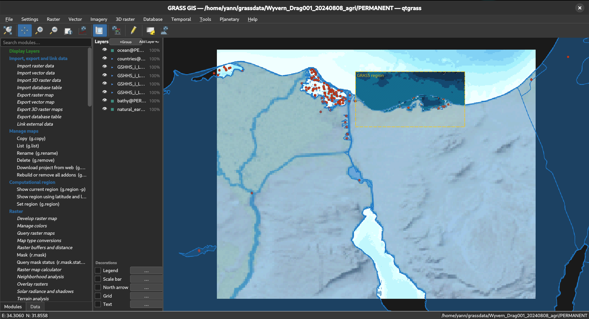

# qtgrass

A native Qt6 graphical user interface for [GRASS GIS](https://grass.osgeo.org),
replacing the legacy wxPython GUI with a C++/Qt application.



## Features

- **Map canvas** — raster and vector rendering, layer tree, compositing,
  map swipe, decorations, OSM/WMS/WMTS basemaps, and identify/pick tools.
- **Module dialogs** — dialogs generated from GRASS module XML, with a
  searchable toolbox and support for standalone `--module` launches.
- **Workspace support** — open and save `.gxw` workspaces, including
  qtgrass-specific display decorations.
- **Graphical modeler** — node-graph editor for `.gxm` models.
- **Temporal tools** — STRDS/STVDS animation player with MP4 export and
  time-series plotting.
- **Print composer** — layout editor with PDF, PNG and SVG export.
- **Database manager** — attribute table browser, SQL editor and field
  calculator.
- **Imagery** — supervised classification (`i.class`) with training canvas
  and scatter plots.
- **Georectification** — GCP table, RMS display and georectification dialog.
- **3-D view** — OpenGL terrain rendering through the `nviz` front end.
- **Additional tools** — vector digitizer, map calculator, region editor,
  profile/histogram plots, network analysis, map history, script runner,
  planetary/crater tools, and grass-addons menus.

## Requirements

- Qt 6 (Core, Gui, Widgets, Network, Xml, Concurrent, Sql, PrintSupport,
  Svg, Charts, OpenGL, OpenGLWidgets)
- GRASS GIS 8.0 or later, including its development headers and libraries
- PROJ
- GDAL
- OpenGL and a C++17 compiler
- CMake 3.22 or later

On Debian/Ubuntu, the build dependencies are listed in `debian/control`:

```sh
sudo apt install build-essential cmake \
    qt6-base-dev qt6-base-dev-tools libqt6svg6-dev qt6-charts-dev \
    libcups2-dev libgdal-dev libgl1-mesa-dev libglu1-mesa-dev \
    grass-dev
```

`grass-dev` must match the GRASS installation you build against. A source
installation under `/usr/local/grass86` works as well; pass its path through
`GRASS_PREFIX`.

## Building

See [INSTALL.md](INSTALL.md) for the full dependency list, CMake options and
packaging instructions. The included `Makefile` wraps the CMake build:

```sh
# Release build (RelWithDebInfo) into ./build/
make build

# Debug build with full symbols into ./build-debug/
make build-debug
```

GRASS is detected automatically from `/usr/local/grass[0-9]*`; override it
when needed:

```sh
make build GRASS_PREFIX=/usr/local/grass86
```

The equivalent direct CMake invocation is:

```sh
cmake -S . -B build \
    -DCMAKE_BUILD_TYPE=RelWithDebInfo \
    -DGRASS_PREFIX=/usr/local/grass86
cmake --build build -j"$(nproc)"
```

Install the binary into the GRASS `bin` directory:

```sh
sudo make install GRASS_PREFIX=/usr/local/grass86
```

## Running

Start the full GUI with the startup wizard:

```sh
qtgrass
```

Open a workspace directly:

```sh
qtgrass path/to/workspace.gxw
```

Open a standalone GRASS module dialog:

```sh
qtgrass --module r.slope.aspect elevation=dem slope=slope
```

qtgrass also implements the GRASS `--qtui` hook, which is parsed into a module
name and its arguments:

```sh
r.slope.aspect --qtui elevation=dem slope=slope
# equivalent to:
qtgrass --qtui-cmd "r.slope.aspect elevation=dem slope=slope"
```

If `GISBASE` is not set, the location used at build time is baked in. It can
also be overridden at runtime:

```sh
qtgrass --grassdir /usr/local/grass86
```

Set `QTGRASS_DEBUG=1` to write startup and Qt log output to
`~/qtgrass-debug.log`. Debug builds enable this automatically.

## Packaging

Unsigned Debian packages can be built with:

```sh
make deb        # release .deb
make deb-debug  # debug .deb with full symbols
```

The resulting packages are written to the parent directory. A wrapper script,
`qtgrass-debug`, is installed alongside the binary; it enables full logging
and mirrors output to `~/qtgrass-debug.log`.

## Project layout

| Path | Contents |
| --- | --- |
| `src/canvas/` | Map canvas, display driver, layers, decorations |
| `src/module/` | Module XML parser and parameter dialogs |
| `src/workspace/` | `.gxw` workspace serialisation |
| `src/modeler/` | Graphical modeler |
| `src/temporal/` | Temporal dataset browser and animation |
| `src/layout/` | Print composer and layout items |
| `src/attrib/` | Attribute tables, SQL editor, field calculator |
| `src/imagery/` | Image classification and training tools |
| `src/georect/` | Georectification and GCP handling |
| `src/nviz/` | 3-D visualisation |
| `src/toolbox/`, `src/tools/` | Module toolbox and auxiliary tools |
| `src/startup/` | Startup wizard, CRS and mapset browser |
| `src/addon/` | grass-addons menu generation |
| `cmake/` | GRASS discovery and addons scanning |
| `debian/` | Debian packaging metadata |
| `doc/api/` | Doxygen-generated API documentation |

Menu placement for grass-addons modules is controlled by
[`ADDONS_MENU.md`](ADDONS_MENU.md).

## License

Released into the public domain under the [Unlicense](LICENSE).

## Author

Yann Chemin <dr.yann.chemin@gmail.com>
